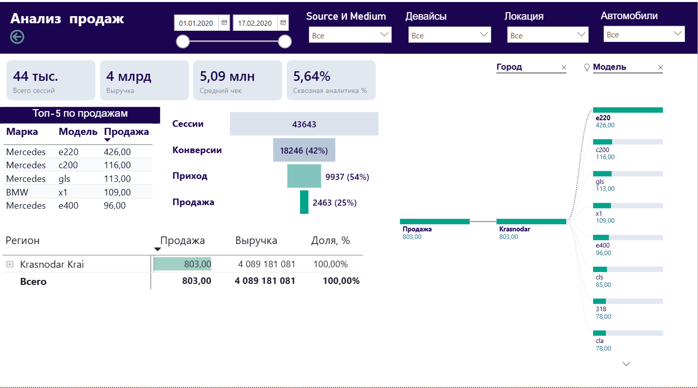
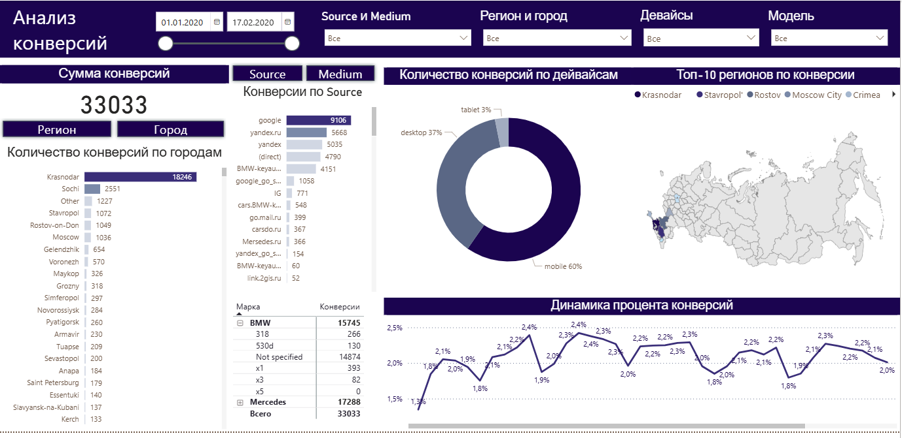
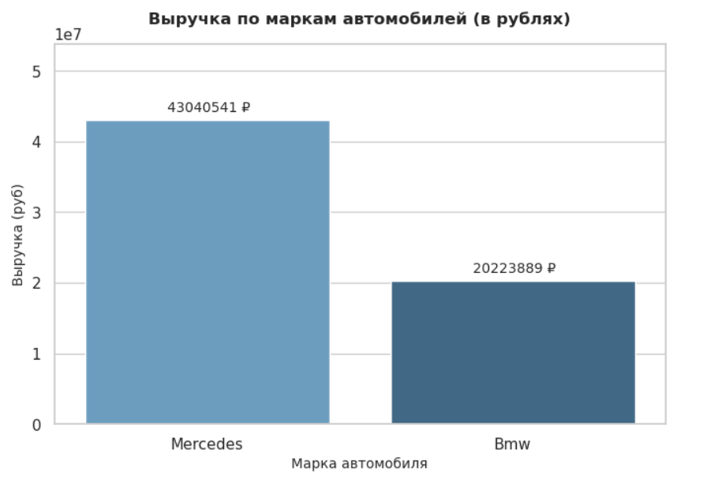
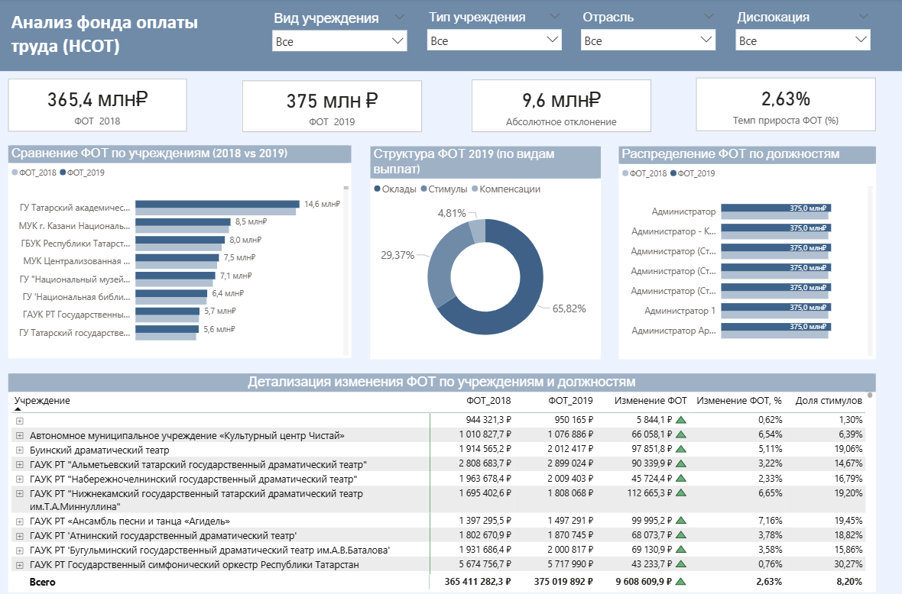

# Портфолио проектов по анализу данных (Data Analytics Portfolio)

Репозиторий содержит комплексные проекты в области коммерческой и HR-аналитики. В рамках работы реализован полный цикл обработки и анализа данных (End-to-End Analytics): от автоматизации ETL-процессов и разведочного анализа (EDA) до моделирования связей, написания DAX-мер и проектирования интерактивных аналитических панелей.

---

## Проект 1. Анализ продаж и конверсии (Car Sales Analytics)

**Бизнес-цель:** Оценка структуры выручки, динамики продаж по брендам и моделям, а также количественный анализ показателей конверсии на этапах воронки продаж.

### Технологический стек и выполненные задачи:

* **Power Query & M-код (ETL-процессы):**
  * Подключение и объединение источников данных из файлов Microsoft Excel.
  * Очистка данных, приведение типов к корректным форматам, фильтрация и удаление дубликатов.
  * Группировка данных и нормализация текстовых значений (приведение стиля и регистров).
  * Прямая оптимизация и редактирование скриптов M-кода в редакторе шагов Power Query.

* **Моделирование данных & DAX (Power BI):**
  * Построение логической схемы данных и настройка связей между справочниками и таблицами фактов.
  * Создание изолированных справочных таблиц и динамических DAX-мер для выполнения расчетов (выручка, средний чек, конверсия).
  * Настройка детализации и кросс-страничной навигации (Drill-through).

* **Визуализация и UX/UI дашборда:**
  * Применение лучших практик бизнес-визуализации: сбалансированная цветовая палитра, иерархия акцентов, информативные KPI-карточки.

* **Python (Jupyter Notebook):**
  * Разведочный анализ данных (EDA) с использованием библиотек Pandas, Seaborn и Matplotlib.
  * Проверка качества данных, обработка пропусков `NaN`, нормализация названий и консолидация мультивалютных транзакций к единой базовой валюте (RUB).

---

### Структура отчета и визуализация:

#### 1. Анализ выручки и структуры продаж
Анализ финансовых показателей в разрезе брендов, моделей и временных периодов.


#### 2. Анализ конверсии и воронки продаж
Моделирование этапов взаимодействия с клиентом (от первичной заявки до заключения сделки) с фиксацией точек потери конверсии.


#### 3. Разведочный анализ данных на Python (EDA)
Результат стандартизации наименований брендов и конвертации выручки в единый валютный базис.


---

### Ключевые аналитические выводы:
* **Концентрация выручки:** Преобладающую долю в общей выручке формирует сегмент бренд-класса Mercedes за счет высокого среднего чека при меньшем объеме сделок.
* **Узкие места воронки:** Наибольшее снижение конверсии зафиксировано при переходе от первичной заявки к прохождению тест-драйва, что указывает на необходимость оптимизации процессов квалификации лидов.

---

## Проект 2. HR-аналитика фонда оплаты труда (HR Payroll Analytics)

**Бизнес-цель:** Анализ структуры и динамики регионального фонда оплаты труда (ФОТ), контроль численности персонала и проведение сопоставительного анализа систем оплаты труда (НСОТ-4 vs НСОТ-2).

### Технологический стек и выполненные задачи:
* **Power Query:** Автоматизация загрузки Excel-файлов, очистка кадровых реестров, удаление дубликатов, сопоставление штатных расписаний.
* **Power BI & DAX:** Моделирование связей, расчет отклонений ФОТ, разработка матричных визуализаций и декомпозиция ключевых показателей.
* **Визуализация:** Оформление отчета в соответствии с гайдлайнами бизнес-аналитики.

### Визуализация отчета:

Интерактивный дашборд для мониторинга фонда оплаты труда и сравнительного анализа систем оплаты:


---

## Структура репозитория
```text
├── проекты/            # Графические материалы и скриншоты отчетов
├── data/               # Исходные наборы данных (Excel / CSV)
├── notebooks/          # Ноутбуки Jupyter с кодом обработки данных на Python
├── power_bi/           # Файлы аналитических панелей Power BI (.pbix)
└── README.md           # Документация проекта
